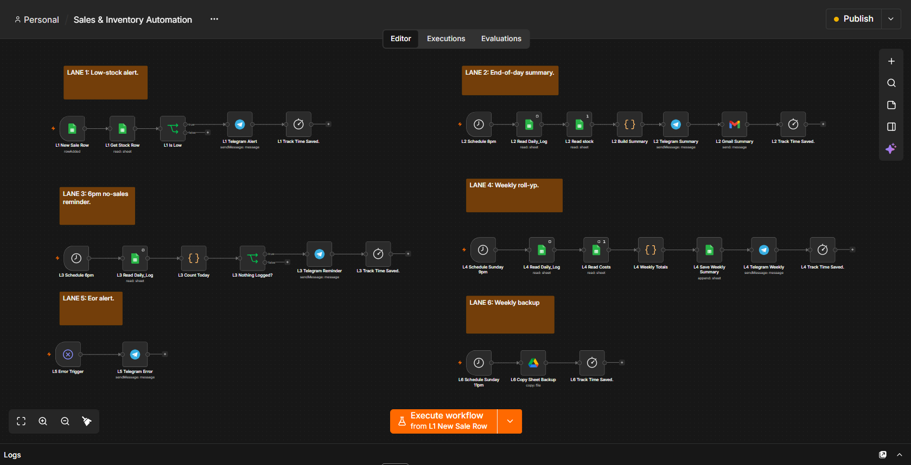
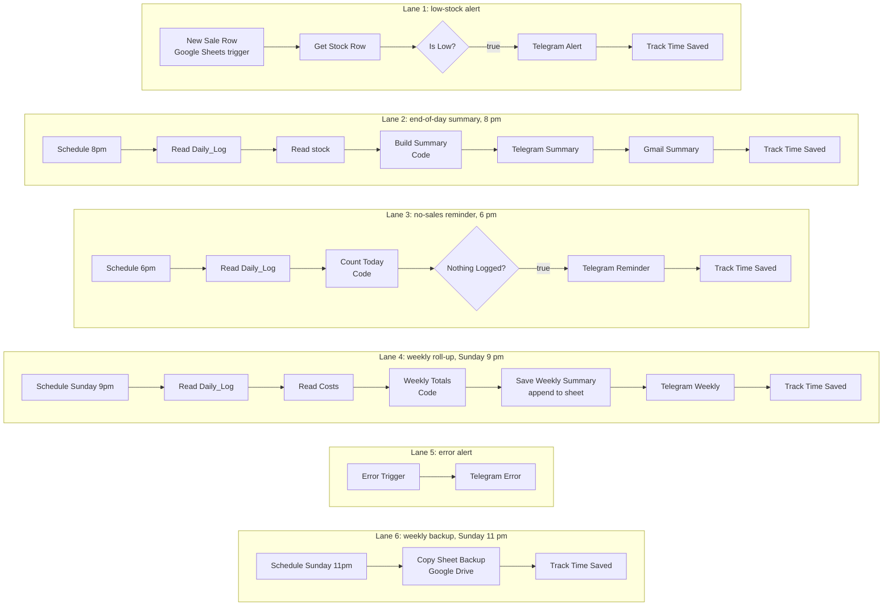

# Sales & Inventory Automation

A small juice business was tracking sales and stock by hand. I built an n8n automation so the owner only logs sales, batches, and costs in Google Sheets. The spreadsheet does the arithmetic, and n8n does the watching.

*The n8n canvas: six lanes, each with its own trigger. The screenshot shows workflow structure only. No credentials, names, or figures appear in it.*

## What the owner does

The owner logs sales, batches, and costs in Google Sheets, picking the flavour and size from dropdowns. Nothing else is required.

## What happens automatically

| Lane | Trigger | Steps | Result |
| --- | --- | --- | --- |
| 1. Low-stock alert | A new sale row is added (Google Sheets trigger) | Get Stock Row, Is Low (IF), Telegram Alert | A Telegram message when a flavour, or its stickers, run low |
| 2. End-of-day summary | Schedule, 8 pm | Read Daily_Log, Read stock, Build Summary (Code), Telegram Summary, Gmail Summary | Bottles sold, revenue, top seller, and exactly which flavours and sizes were sold, on Telegram and by email |
| 3. No-sales reminder | Schedule, 6 pm | Read Daily_Log, Count Today (Code), Nothing Logged (IF), Telegram Reminder | A nudge if nothing has been logged yet |
| 4. Weekly roll-up | Schedule, Sunday 9 pm | Read Daily_Log, Read Costs, Weekly Totals (Code), Save Weekly Summary (append to the sheet), Telegram Weekly | Revenue, costs, profit, and flavours sold, saved to the sheet and sent to the owner |
| 5. Error alert | Error Trigger | Telegram Error | A message if anything breaks |
| 6. Weekly backup | Schedule, Sunday 11 pm | Copy Sheet Backup (Google Drive) | A copy of the sheet saved in Google Drive |

Every lane ends with a Track Time Saved node.

## How the lanes connect

## Three things I would tell anyone building something similar

1. **Let the spreadsheet do the arithmetic and let automation handle the reporting.** Fewer moving parts means fewer things to break.
2. **Give every node a unique name when several workflows share one canvas.** Every node here carries its lane prefix, from L1 to L6, so no two nodes ever share a name.
3. **Test sheet protection from a second account.** Owners are never blocked by their own locks.

## Handover

I also wrote a short daily guide so the owner can run the system without me. A system nobody understands is a system nobody uses.

## Tools

n8n, Google Sheets, Telegram Bot API, Gmail, Google Drive, JavaScript Code nodes.

## About the data

The business name and its figures are kept private, and no credentials appear anywhere in this folder.
